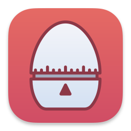
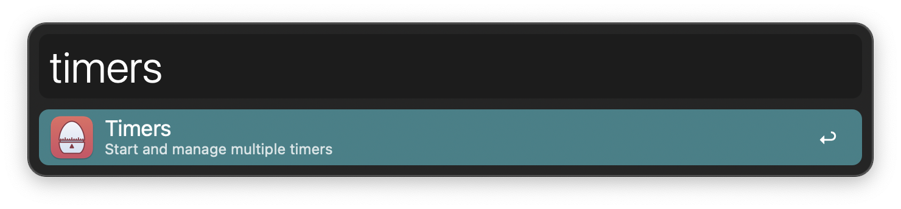
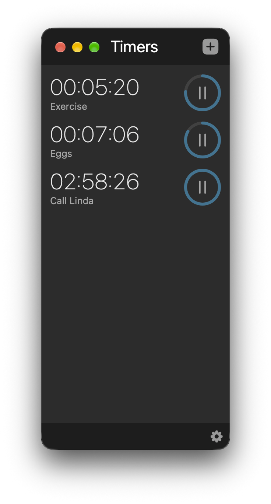
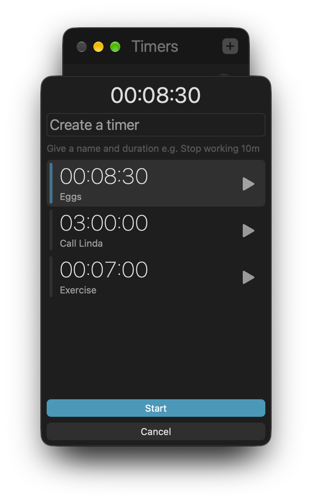

#  Timers Alfred Workflow

Start and manage multiple timers

[⤓ Install on the Alfred Gallery](https://alfred.app/workflows/alfredapp/timers)

## Usage

Launch an external timers interface via the `timers` keyword.

Add a new timer with <kbd>⌘</kbd><kbd>N</kbd>.

Restart and remove running timers via their right-click context menu.
